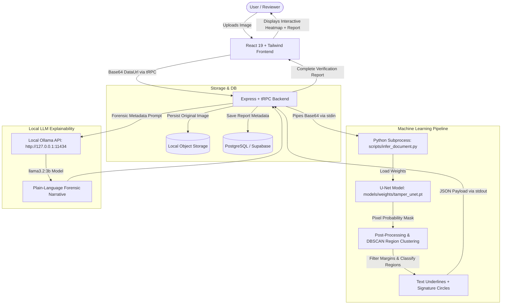

# VerityLens — Complete Project Architecture & Technical Explanation

> **Purpose of this document:**  
> This guide provides an in-depth, end-to-end technical explanation of how VerityLens works. Whether you are presenting this project in a college viva, technical interview, code review, or explaining it to a fellow engineer, this document covers everything from user interaction to deep learning inference and local LLM narrative generation.

---

## 1. Executive Summary

**VerityLens** is an end-to-end, privacy-preserving, institutional document forgery detection system. It allows a user to upload a scanned document, certificate, invoice, or legal form and immediately inspect:
1. **Whether the document has been altered** (Forgery Likelihood: 0–100%).
2. **Where the tampering occurred** (Visual XAI overlay with red underlines under tampered text and red circles around suspect signatures or seals).
3. **Why the model reached that conclusion** (A natural language explanation generated by a locally running Large Language Model).
4. **Instant Testing Mode** (Zero authentication friction: anyone can upload, analyze, and review past history immediately).

### Key Architectural Pillars
- **100% Local Execution:** No document bytes or forensic findings are ever sent to external cloud APIs like OpenAI or Google Cloud.
- **Explainable AI (XAI):** Instead of a "black-box" yes/no classification, the system isolates exact pixel clusters and explains them in plain English.
- **Three-Tier Decision Framework:**
  - **Genuine (0–34%):** Clean document, no anomalous clustering.
  - **Needs Human Review (35–69%):** Subtle anomalies or scanner noise that requires human review.
  - **Forgery Suspected (70–99%):** High-confidence tampering clusters identified.

---

## 2. High-Level System Architecture

---

## 3. What Happens When a Document is Uploaded? (Step-by-Step Lifecycle)

### Step 1: Frontend Ingestion & Pre-Validation (`client/src/pages/Home.tsx`)
1. The user drags and drops or browses for an image file.
2. The browser validates client-side:
   - **Allowed formats:** PNG, JPEG, WEBP.
   - **Size limit:** Maximum 8 MB.
3. The file is converted into a base64 Data URL string via the browser's `FileReader` API.
4. When the user clicks **"Analyze document"**, the frontend triggers the tRPC mutation `trpc.analysis.create.useMutation()`.

### Step 2: Backend Orchestration (`server/routers.ts`)
1. The tRPC `analysis.create` procedure receives `{ fileName, mimeType, dataUrl }`.
2. **Guest User Fallback:** If the visitor is not signed in, `getOrCreateGuestUser()` in `server/db.ts` assigns the request to an institutional guest reviewer record, ensuring unauthenticated testing works seamlessly.
3. The raw base64 buffer is decoded into binary bytes and persisted to the local file storage under `documents/<userId>/<uuid>-<fileName>`.
4. The server launches the Python ML inference process using Node's `child_process.spawn`.

### Step 3: Python ML Inference Engine (`scripts/infer_document.py`)
This is the core forensic vision pipeline. It executes the following sub-steps:

1. **Decoding & Tensor Preparation:**
   - Decodes the raw base64 stream from `sys.stdin`.
   - Normalizes image dimensions while preserving aspect ratio.
   - Resizes into standard input dimensions ($256 \times 256 \times 3$) and normalizes with ImageNet mean and standard deviation:
     $$\mu = [0.485, 0.456, 0.406], \quad \sigma = [0.229, 0.224, 0.225]$$

2. **U-Net Segmentation Pass:**
   - The tensor is passed through the compact U-Net architecture (`tamper_unet.pt` with an `efficientnet-b0` encoder).
   - Raw logits are passed through a Sigmoid activation function to generate a continuous probability matrix where every pixel value ranges from $0.0$ (genuine) to $1.0$ (tampered).
   - The $256 \times 256$ probability mask is remapped and interpolated back to the original image dimensions.

3. **Margin & Scan Noise Rejection:**
   - Raw scanners and photocopiers inherently produce high-frequency noise along physical document borders and margins.
   - The detector masks out the outer 3.5% border of the document page so scanner edge artifacts do not trigger false tampering alarms.

4. **Connected-Component & Cluster Extraction:**
   - Identifies candidate "hot cells" exceeding threshold ($\ge 0.45$).
   - Connected components and bounding boxes are grouped into spatial regions.
   - Filter criteria: components with fewer than 4 contiguous cells are rejected as noise.

5. **Region Semantic Classification:**
   - Each flagged region is analyzed based on geometry and position:
     - **Altered Text:** Characterized by horizontal aspect ratio ($\text{width} > 1.25 \times \text{height}$) and low vertical height.
     - **Copied Signature:** Characterized by location in the lower third or signature band of the document, with flowing contours.
     - **Modified Seal / Stamp / Logo:** Characterized by roughly square/circular aspect ratios ($0.7 \le \text{aspect ratio} \le 1.4$).

6. **Visual Overlay Rendering:**
   - Rather than blinding the user with a generic red haze over clean parts of the page:
     - **Altered text** is highlighted with a crisp red underline directly beneath the characters.
     - **Suspect signatures and seals** are enclosed in a red circular boundary.
   - The resulting composite image is encoded as a base64 JPEG overlay and output to `stdout` along with normalized bounding coordinates ($x, y, w, h$).

7. **Evidence-Based Scoring Formula:**
   - A single edited word in a 1,000-word document represents only $\sim 0.1\%$ of total pixels, so a simple global average would wash out real forgeries.
   - The forgery likelihood score is computed from:
     $$\text{Score} = f(\text{Top-3 Cluster Means}, \text{Peak Confidence}, \text{Saturated Pixel Density})$$
   - Scores are mapped to the three decision bands: **Genuine (0–34)**, **Needs Review (35–69)**, and **Forgery Suspected (70–99)**.

### Step 4: Local AI Explainer (`server/_core/llm.ts`)
Once the ML engine returns its structured JSON findings, the Node server invokes the local LLM:

1. **Context Construction:**
   - A prompt is assembled containing:
     - Document filename
     - Decision verdict (Genuine / Review / Forged)
     - Forgery Likelihood score (%)
     - List of detected indicators (e.g., `["altered text", "copied signature"]`)
     - Normalized coordinates and model notes
2. **Ollama Execution:**
   - An HTTP POST request is sent to `http://127.0.0.1:11434/api/generate` running `llama3.2:3b`.
   - The LLM is instructed under a strict institutional reviewer persona:
     > *"You write concise, cautious verification explanations for institutional document reviewers. Never claim legal certainty or official verification. Explain the model result in plain language. If the decision is review, state clearly that a human reviewer must decide."*
3. **Dynamic Fallback:**
   - If Ollama is offline or on a slow CPU timeout (60s limit), the system automatically constructs an adaptive fallback narrative based on the detected indicators, ensuring zero user-facing crashes.

### Step 5: Database Persistence & Storage (`server/db.ts`)
1. The rendered overlay image is saved in object storage at `analyses/<userId>/<uuid>-overlay.jpg`.
2. A row is inserted into the `documentAnalyses` PostgreSQL table containing:
   - `fileName`, `mimeType`, `originalUrl`, `overlayUrl`
   - `prediction` (`genuine` or `forged`)
   - `forgeryScore` (integer 0–100)
   - `tamperingTypes` (JSON array of strings)
   - `flaggedRegions` (JSON array of bounding boxes)
   - `explanation` (LLM narrative text)
   - `modelVersion` (provenance tag)
   - `createdAt` (timestamp)

### Step 6: Frontend Reactive Report Presentation
1. The React app receives the full report payload via tRPC.
2. The user interface instantly displays:
   - **Inspection Toggle:** One-click toggle between **Marked Evidence** and **Clean Original** document view.
   - **Visual Overlays:** Interactive SVG/HTML overlays with red underlines and circular tags showing exact model confidence.
   - **Detected Indicators:** Color-coded pills (purple for signatures, blue for seals, rose for altered text).
   - **Plain-Language Explanation:** The complete AI narrative.
   - **Auto-Sync History:** The report is immediately saved and visible in the **Analysis history** tab.

---

## 4. In-Depth: The Machine Learning Model (U-Net)

### Why U-Net?
Standard classification convolutional networks (such as ResNet or VGG) take an image and output a single class label (`forged` vs `genuine`). For legal and institutional document verification, this is insufficient because:
- Reviewers cannot verify **why** or **where** the model claims an image is altered.
- Small tampering (e.g. changing "$100" to "$900") gets lost in global feature pooling.

**U-Net** solves this by performing **dense semantic segmentation**:
- **Encoder:** Downsamples image through convolutional blocks to capture multi-scale semantic features (using EfficientNet-b0 pre-trained on ImageNet).
- **Decoder:** Upsamples the feature maps back to pixel resolution.
- **Skip Connections:** Directly connect low-level spatial detail from the encoder to the decoder, allowing the model to pinpoint subtle character-level edge inconsistencies, resampling artifacts, and font boundary discrepancies.

### Training Details
- **Training Script:** [scripts/train.py](file:///c:/Users/ASUS/Desktop/nandhu%20projects/document%20fake%20detection/fake-documentry-/scripts/train.py)
- **Loss Function:** Combined Dice Loss + Binary Cross-Entropy with Logits:
  $$\mathcal{L} = \mathcal{L}_{\text{Dice}}(\hat{y}, y) + \mathcal{L}_{\text{BCE}}(\hat{y}, y)$$
  - Dice loss prevents the model from collapsing to all-zero predictions on imbalanced document pages where tampered text occupies $< 1\%$ of pixels.
- **Shipped Checkpoint:** [models/weights/tamper_unet.pt](file:///c:/Users/ASUS/Desktop/nandhu%20projects/document%20fake%20detection/fake-documentry-/models/weights/tamper_unet.pt) (25.3 MB).

---

## 5. In-Depth: The Local Large Language Model (Ollama)

### Why Run Ollama Locally?
1. **Privacy & Compliance:** Institutional certificates, student diplomas, and financial invoices contain sensitive Personally Identifiable Information (PII). Sending these documents or their text to commercial cloud APIs violates strict data privacy regulations (e.g. GDPR, HIPAA, FERPA).
2. **Zero Operating Cost:** Running `llama3.2:3b` locally requires no API keys, tokens, or subscription costs.
3. **Explainability Translation:** Raw neural network coordinates (e.g., `[x: 0.24, y: 0.58, w: 0.12, h: 0.04]`) are meaningless to non-technical reviewers. The LLM translates these numeric tensors into human-understandable English:
   > *"The model identified a suspicious alteration on the invoice total in the middle section of the page, where pixel-level font inconsistencies deviate from the document's global baseline."*

---

## 6. Viva & Interview Questions & Answers

If you are asked about this project during a demonstration or interview, here are authoritative answers to expected questions:

### Q1: What is the main problem this project solves?
> **Answer:** Traditional document verification either relies on slow manual human inspection or opaque "black-box" classifiers that give no proof. VerityLens solves this by providing **Explainable AI (XAI)**: it detects forgery at the pixel level, visually underlines altered text, circles suspicious seals/signatures, and generates a plain-language narrative explaining the evidence, all while running 100% locally to protect document privacy.

### Q2: Why didn't you use a standard classification model like ResNet?
> **Answer:** A document edit might only occupy 50 pixels out of 2 million. Global pooling in ResNet dilutes this small edit, leading to high false-negative rates. U-Net uses skip connections between the encoder and decoder to preserve fine-grained spatial resolution, allowing it to localize micro-edits such as a single altered digit or a pasted signature.

### Q3: How do you handle scanner noise and document borders?
> **Answer:** In `scripts/infer_document.py`, we implement margin exclusion and cluster filtering. The outer 3.5% border of the document is masked out to discard edge shadows from scanner beds. Furthermore, individual isolated pixels are filtered out using connected-component analysis, requiring a minimum cluster density before flagging an anomaly.

### Q4: Why use Ollama instead of GPT-4?
> **Answer:** Institutional documents often contain confidential personal or financial data. Sending documents to cloud endpoints poses data leakage risks. Ollama runs compact open-weight models (`llama3.2:3b`) entirely on the local device, achieving high-quality narrative explanations with zero cloud dependency and zero API costs.

### Q5: How does the system score documents?
> **Answer:** Rather than computing a global average (which dilutes localized edits), we compute cluster evidence based on peak region confidence, top-3 region density, and saturated pixel count. This maps to a 0–100% score partitioned into three bands: **Genuine (0–34%)**, **Needs Human Review (35–69%)**, and **Forgery Suspected (70–99%)**.

---

## 7. Project File Sitemap

| File / Folder | Role & Description |
|---|---|
| [client/src/pages/Home.tsx](file:///c:/Users/ASUS/Desktop/nandhu%20projects/document%20fake%20detection/fake-documentry-/client/src/pages/Home.tsx) | Main React UI: drag-and-drop, instant testing, marked vs clean inspection toggle, history view. |
| [server/routers.ts](file:///c:/Users/ASUS/Desktop/nandhu%20projects/document%20fake%20detection/fake-documentry-/server/routers.ts) | tRPC backend router: `analysis.create`, `analysis.history`, guest access, Python process invocation. |
| [server/db.ts](file:///c:/Users/ASUS/Desktop/nandhu%20projects/document%20fake%20detection/fake-documentry-/server/db.ts) | Database access layer: guest user handling, query execution, Supabase connection pool management. |
| [server/_core/llm.ts](file:///c:/Users/ASUS/Desktop/nandhu%20projects/document%20fake%20detection/fake-documentry-/server/_core/llm.ts) | Local Ollama LLM client with dynamic structured fallback. |
| [scripts/infer_document.py](file:///c:/Users/ASUS/Desktop/nandhu%20projects/document%20fake%20detection/fake-documentry-/scripts/infer_document.py) | Python ML inference worker: U-Net execution, clustering, red underlines, signature circles, scoring. |
| [scripts/train.py](file:///c:/Users/ASUS/Desktop/nandhu%20projects/document%20fake%20detection/fake-documentry-/scripts/train.py) | PyTorch U-Net training script with Dice + BCE loss and self-test verification. |
| [models/weights/tamper_unet.pt](file:///c:/Users/ASUS/Desktop/nandhu%20projects/document%20fake%20detection/fake-documentry-/models/weights/tamper_unet.pt) | Shipped pre-trained PyTorch model checkpoint. |
| [samples/](file:///c:/Users/ASUS/Desktop/nandhu%20projects/document%20fake%20detection/fake-documentry-/samples/) | 16 pre-bundled test documents (genuine letters, invoices, forged certificates, signatures). |
| [SETUP_GUIDE.md](file:///c:/Users/ASUS/Desktop/nandhu%20projects/document%20fake%20detection/fake-documentry-/SETUP_GUIDE.md) | Step-by-step setup, model training, Ollama installation, and testing guide. |
